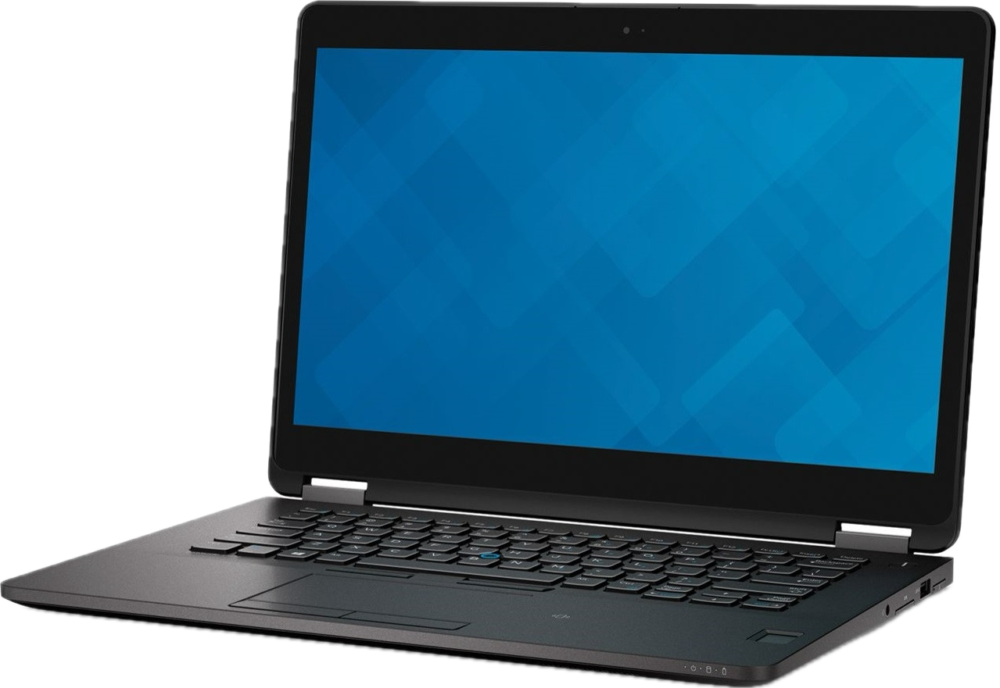
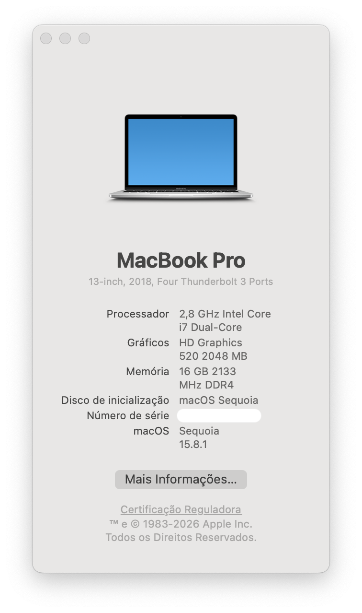

# Dell Latitude E7470 **·** macOS Sequoia (OpenCore)




OpenCore-based Hackintosh configuration for the Dell Latitude E7470 with Intel Core i7-6600U, Intel HD Graphics 520 and <strong>BCM94360NG</strong> Wi-Fi/Bluetooth.

This configuration prioritizes a safe, stable and responsive macOS experience, with Wi-Fi, Bluetooth and Apple Continuity features enabled through the required macOS patches and configuration.


[](https://github.com/acidanthera/OpenCorePkg)

[-informational?style=flat&color=1BC5FB)](https://www.intel.com/content/www/us/en/products/sku/88192/intel-core-i76600u-processor-4m-cache-up-to-3-40-ghz/specifications.html)


<br>

## ➤ My Hardware


- **Model:** Dell Latitude E7470
- **Processor:** **[Intel Core i7-6600U](https://www.intel.com/content/www/us/en/products/sku/88192/intel-core-i76600u-processor-4m-cache-up-to-3-40-ghz/specifications.html)** · 2.60 GHz base / up to 3.40 GHz Turbo · Skylake · 6th generation · 14 nm
- **Graphics:** Intel HD Graphics 520
- **Memory:** 16 GB DDR4-2133 · Dual Channel
- **Display:** 14" QHD · 2560 × 1440 · Touch
- **Storage:** 1 TB M.2 2280 NVMe SSD
- **WLAN + Bluetooth:** Fenvi BCM94360NG · 802.11a/b/g/n/ac · Bluetooth 4.0
- **LAN:** Gigabit Ethernet · RJ-45
- **USB:** 3 × USB 3.0
- **SD Card:** SD 4.0
- **Audio:** Realtek ALC3235 · 24-bit · layout-id 11
- **Camera:** 1920 × 1080 · FHD
- **Keyboard:** ABNT2 · Backlit
- **Trackpad:** ALPS Touchpad
- **Fingerprint Reader:** Yes
- **Smart Card:** Yes
- **SMBIOS:** *MacBookPro15,2*
<br>

## ➤ What's Working
| Functionality | Dependencies |
|---|---|
| Intel HD 520 Graphics <em>(including graphics acceleration)</em><br>HDMI (including 4K 30Hz) with digital audio passthrough<br>miniDP | - **[WhateverGreen](https://github.com/acidanthera/WhateverGreen)** · DeviceProperties |
| USB ports | - USBPorts.kext <em>(custom mapping)</em> |
| Internal camera | - USBPorts.kext <em>(correct USB port mapping)</em> |
| Shutdown / Reboot / Sleep / Wake | - SSDT-E7470.aml · GPRW patch |
| Speakers and headphone jack | - **[AppleALC](https://github.com/acidanthera/AppleALC)** · layout-id 11<br>- VerbStub |
| Intel Gigabit Ethernet | - **[IntelMausi](https://github.com/acidanthera/IntelMausi)** |
| iCloud Services | - Valid, unique SMBIOS generated with **[GenSMBIOS](#recommended-tools)** |
| WiFi | - BCM94360NG<br>- IOSkywalkFamily.kext<br>- IO80211FamilyLegacy.kext<br>- AMFIPass.kext<br>- **[OpenCore Legacy Patcher](https://dortania.github.io/OpenCore-Legacy-Patcher/)** root patches|
| Bluetooth | - BCM94360NG<br>- USBPorts.kext (<em>correct USB port mapping</em>)<br>- **[OpenCore Legacy Patcher](https://dortania.github.io/OpenCore-Legacy-Patcher/)** root patches |
| Continuity:<br>&nbsp;&nbsp;– <em>Handoff</em><br>&nbsp;&nbsp;– <em>Universal Clipboard</em><br>&nbsp;&nbsp;– <em>Universal Control</em><br>&nbsp;&nbsp;– <em>Continuity Camera</em><br>&nbsp;&nbsp;– <em>Instant Hotspot</em><br>&nbsp;&nbsp;– <em>iPhone Cellular Calls / SMS</em> | - BCM94360NG<br>- USBPorts.kext (<em>correct USB port mapping</em>)<br>- **[OpenCore Legacy Patcher](https://dortania.github.io/OpenCore-Legacy-Patcher/)** root patches |
| AirDrop | - BCM94360NG<br>- USBPorts.kext (<em>correct USB port mapping</em>)<br>- **[OpenCore Legacy Patcher](https://dortania.github.io/OpenCore-Legacy-Patcher/)** root patches |
| AirPlay | - BCM94360NG<br>- USBPorts.kext (<em>correct USB port mapping</em>)<br> - **[OpenCore Legacy Patcher](https://dortania.github.io/OpenCore-Legacy-Patcher/)** root patches |
| Keyboard + backlight | - **[VoodooPS2](https://github.com/SkyrilHD/VoodooPS2)**<br>- **[BrightnessKeys](https://github.com/acidanthera/BrightnessKeys)** |
| Trackpad with multitouch gestures | - **[VoodooPS2](https://github.com/SkyrilHD/VoodooPS2)** |
| SD Card Reader | - **[RealtekCardReader](https://github.com/0xFireWolf/RealtekCardReader)**<br>- **[RealtekCardReaderFriend](https://github.com/0xFireWolf/RealtekCardReaderFriend)** |
| Battery status | - **[VirtualSMC](https://github.com/acidanthera/VirtualSMC)** SMCBatteryManager|
| CPU / thermal sensors | - **[VirtualSMC](https://github.com/acidanthera/VirtualSMC)** SMCProcessor<br>- **[VirtualSMC](https://github.com/acidanthera/VirtualSMC)** SMCDellSensors |
<br>

## ➤ What's Not Working
| Functionality | Notes |
|---|---|
| Continuity:<br>&nbsp;&nbsp; - *Sidecar* | The handshake is successful, but there is no video output; the receiving display remains black. |
| Touchscreen | Not Tested |
| Fingerprint Reader | Not Tested |
| Smart Card | Not Tested |
| HDMI + Internal Display | Connecting an HDMI display can cause the internal display to remain black. See [HDMI + Internal Display](#-hdmi--internal-display) for the workaround. |
<br>

## ➤ Workarounds

### — HDMI + Internal Display

When an HDMI display is connected, the internal display may turn black and remain black even after the HDMI cable is disconnected.

#### Observed behavior
| Action | Internal Display | HDMI Display |
|---|---|---|
| System running normally | Working | — |
| Connect HDMI | Turns black | Working |
| Disconnect HDMI | Remains black | — |
| Sleep → disconnect HDMI → wake | Working | — |
| Sleep → disconnect HDMI → wake → connect HDMI | Working | Working |

#### Workaround

1. Put macOS into **Sleep**.
2. Disconnect the HDMI cable while the system is asleep.
3. Wake the computer.
4. The internal display should resume working normally.
5. If an external display is needed, reconnect the HDMI cable after waking.

After this sequence, both the internal and HDMI displays can operate simultaneously.

<br>

## ➤ Benchmarks

### — Geekbench 7.0.0 for macOS AVX2
> **Note on benchmark output:** The System Information block below is transcribed exactly as displayed by the Geekbench application, without modification. The GPU and SMBIOS identifiers shown reflect the spoofed Kaby Lake iGPU identity and the SMBIOS used by this build, not the physical hardware. The reported scores, however, reflect the physical hardware (Intel HD Graphics 520 / Core i7-6600U) running under those spoofed identities.

```
System Information:

Model:	   MacBookPro15,2
OS:	       macOS 15.8.1 (Build 24H32)
Processor: Intel Core i7-6600U @ 2.80 GHz
GPU:       Intel(R) UHD Graphics 617
Memory:    16.0 GB DDR4
```

| Benchmark | Run 1 | Run 2 | Run 3 | Average |
|---|---|---|---|---|
| CPU - Single-Core Score |	1035 | 1034 | 1033 | **1034.00**
| CPU - Multi-Core Score | 1849 | 1907 | 1898 | **1884.67**
| GPU - OpenCL Score | 3488 | 3529 | 3487 | **3501.33**
| GPU - Metal Score | 4609 | 4619 | 4639 | **4622.33**

>**Methodology:**
Each benchmark was performed as a set of 3 consecutive runs, with a 5-minute interval between each set. During the intervals, the system remained awake and active. All tests were conducted at an ambient temperature of 20 °C, with the system connected to AC power and no other applications running.
<br>

## ➤ Recommended Tools

| Tool | Stage | Purpose|
|---|---|---|
|**[OpenCore](https://github.com/acidanthera/OpenCorePkg/releases)** |Pre-installation |Bootloader and configuration framework|
|**[GenSMBIOS](https://github.com/corpnewt/GenSMBIOS)** |Pre-installation |Generate unique SMBIOS values                                           |
|**[OC Auxiliary Tools](https://github.com/ic005k/OCAuxiliaryTools/releases)** |Pre & Post-installation |Visual **config.plist** editor · OpenCore and kext updater · OC validation|
|**[USBToolBox](https://github.com/USBToolBox/tool)**                              |Pre-installation |USB port mapping *(Windows)*                                            |
|**[MountEFI](https://github.com/corpnewt/MountEFI)**                              |Pre & Post-installation             |Mount EFI partitions                                                    |
|**[Hackintool](https://github.com/benbaker76/Hackintool)**                       |Pre & Post-installation             |USB port visualization and diagnostics                                  |
| **[OpenCore Legacy Patcher](https://dortania.github.io/OpenCore-Legacy-Patcher/)** | Post-installation | v2.4.1 · Root patches and legacy hardware support                              |
|**[BetterDisplay](https://github.com/waydabber/BetterDisplay)**                   |Post-installation|HiDPI scaling for the internal display|
| **[Brave Browser](https://brave.com/)** | Post-installation | Web browser with built-in ad and tracker blocking |

> **OCLP version note:** OpenCore Legacy Patcher **2.4.1** is the version tested and recommended with this configuration. In my testing, **version 2.5.1** caused an issue in macOS Sequoia where previously saved Wi-Fi networks with Auto-Join enabled did not connect automatically.
<br>

## ➤ What You Need Before Installation

- A computer running **Windows, Linux, or macOS**
- **Python 3** installed and available from the terminal  
  Test with:
    ```
    python3 --version
    ```
- An empty **USB flash drive with 4 GB or more**
- An **Ethernet cable**
- An available **Ethernet port** and **Internet connection**
- A **Dell Latitude E7470** where macOS will be installed
<br>

## ➤ Installation Guide

> **Note:** If your hardware matches the configuration described in [My Hardware](#-my-hardware), this EFI is intended to provide the same functionality described in this guide.
<br><br>
This EFI is the result of extensive testing, refinement, and curation carried out over several months. It is intended to provide a thoroughly tested starting point for other users with the same hardware, helping them avoid having to repeat the same lengthy process of testing, troubleshooting, and configuration.
<br><br>
This guide does not replace or supersede official documentation. It is provided as a practical reference for this specific hardware configuration, and official documentation should always be consulted where applicable.

### Step 1 — Prepare your USB drive

Full instructions: **[Dortania — Making the installer](https://dortania.github.io/OpenCore-Install-Guide/installer-guide/)**

---

### Step 2 — Download and Copy the EFI

Download this repository and copy the entire `EFI` folder to the root of the EFI partition on your USB drive.

The USB should contain the following structure:
```
USB Drive/
├── com.apple.recovery.boot/
│   ├── BaseSystem.dmg
│   └── BaseSystem.chunklist
└── EFI/
    ├── BOOT/
    └── OC/
```

---

### Step 3 — Generate Your SMBIOS

You must generate your own unique set. **Never use SMBIOS values from someone else's repository.**

Run **[GenSMBIOS](https://github.com/corpnewt/GenSMBIOS)** and select option **3 — Generate SMBIOS**, using model **MacBookPro15,2**:

```
Type:         MacBookPro15,2
Serial:       [generated]
Board Serial: [generated]
SmUUID:       [generated]
Apple ROM:    [generated]
```

> Verify your serial at **[Apple's coverage check](https://checkcoverage.apple.com)**. It should return **"Invalid Serial Number"**. If the serial is recognized or returns a different result, generate a new SMBIOS and verify it again before continuing.

---

### Step 4 — Configure the config.plist

Open `EFI/OC/config.plist` using **[OC Auxiliary Tools](https://github.com/ic005k/OCAuxiliaryTools/releases)** and enter your SMBIOS values generated and validated in the [Step 3 — Generate Your SMBIOS](#step-3--generate-your-smbios):

```text
SystemProductName   →  MacBookPro15,2
SystemSerialNumber  →  your generated Serial
MLB                 →  your generated Board Serial
SystemUUID          →  your generated SmUUID
ROM                 →  your generated Apple ROM

```

Save the config.plist after entering the values.

---

### Step 5 — BIOS Settings

Enter the E7470 BIOS by pressing **F2** at boot and apply the following settings:

<pre>
Settings
├─ General
│  ├─ Boot Sequence         → <strong>UEFI</strong>
│  └─ Advanced Boot Options → Enabled Legacy Options ROMs → <strong>Disabled</strong>
│
├─ System Configuration
│  ├─ SATA Operations       → <strong>AHCI</strong>
│  └─ USB Configuration     → <strong>Enable USB Boot Support</strong>
│
├─ Secure Boot
│  └─ Secure Boot Enable    → <strong>Disabled</strong>
│
└─ POST Behavior
   └─ Fastboot              → <strong>Thorough</strong>
</pre>

These settings reflect the BIOS configuration used and tested with this EFI.

---

### Step 6 — Install macOS

1. Boot from the USB installer (**F12** at startup to select the boot device).
2. In the OpenCore picker, select **Install macOS Sequoia**.
3. Open **Disk Utility** and erase the target drive as **APFS / GUID Partition Map**.
4. Start the installation.
5. The system will reboot several times. At each reboot, boot through the OpenCore picker and select the appropriate installer or macOS entry to continue the installation.
6. Once macOS is fully installed, boot into the new system.
7. Use **MountEFI** to mount the internal drive's EFI partition.
8. Copy the `EFI` folder from the USB to the internal drive's EFI partition.
9. Shut down the computer, remove the USB installer, and boot from the internal drive.
<br>

## ➤ Post-installation

### — OpenCore Legacy Patcher

On macOS Sequoia, the legacy Broadcom Wi-Fi support used by the **BCM94360NG** requires additional system patches. Apply the required root patches using **OpenCore Legacy Patcher (OCLP)**.

1. Open the OpenCore Legacy Patcher.
2. Select **Post-Install Root Patch**.
3. Allow OCLP to detect the required patches and select **Start Root Patching**.
4. Reboot when prompted.

> Root patches are installed to the macOS system volume and may need to be reapplied after macOS updates. OCLP will notify you when patches are no longer installed or need to be updated.

### — SMBIOS and Apple ID
Sign in to your Apple ID only after applying your [unique SMBIOS](#step-3--generate-your-smbios). If the system requests additional verification, approve it. This is expected when associating a new hardware configuration.

### — USB Mapping
Correct USB mapping is important for the functionality of this build. The E7470 has internal USB connections used by both the Bluetooth module and the webcam. If these ports are mapped incorrectly, Bluetooth or the internal camera may not function correctly.

The **USBPorts.kext** included in this EFI already contains the tested mapping for the E7470. If you ever need to inspect or rebuild it:

- Open **Hackintool** and go to the **USB** tab.
- Identify each port using its `LocationID`.
- The Bluetooth and webcam ports must both be mapped as `Internal` (type `255`).
- After making changes, update the `USBPorts.kext` in the EFI and reset NVRAM on the next boot if required.

### — HiDPI Scaling
For the 14” QHD 2560×1440 display, I recommend a 67% scaling factor, equivalent to a 1712×963 logical resolution (≈150% UI scaling). Configure this with **[BetterDisplay](https://github.com/waydabber/BetterDisplay)** after installation.

### — Browser
For this configuration, **[Brave Browser](https://brave.com/)** is recommended instead of Safari. In my testing on this Hackintosh, Brave provided reliable video playback, while Safari exhibited video playback issues, including cases where YouTube and other video services failed to play correctly.
<br>

## ➤ EFI Structure

<div align="left">
OpenCore 1.0.8
</div>

```
▼ 📂 EFI
├── ▼ 📂 BOOT
│   └── BOOTx64.efi
└── ▼ 📂 OC
    ├── ▼ 📂 ACPI
    │   └── SSDT-E7470.aml
    ├── config.plist
    ├── ▼ 📂 Drivers
    │   ├── AudioDxe.efi
    │   ├── CrScreenshotDxe.efi
    │   ├── HfsPlus.efi
    │   ├── OpenCanopy.efi
    │   ├── OpenRuntime.efi
    │   ├── ResetNvramEntry.efi
    │   └── ToggleSipEntry.efi
    ├── ▼ 📂 Kexts
    │   ├── AMFIPass.kext
    │   ├── AppleALC.kext
    │   ├── BrightnessKeys.kext
    │   ├── IntelMausi.kext
    │   ├── ▼ IO80211FamilyLegacy.kext
    │   │   └── ▼ Contents
    │   │       └── ▼ PlugIns
    │   │           └── AirPortBrcmNIC.kext
    │   ├── IOSkywalkFamily.kext
    │   ├── Lilu.kext
    │   ├── RealtekCardReader.kext
    │   ├── RealtekCardReaderFriend.kext
    │   ├── RestrictEvents.kext
    │   ├── SMCBatteryManager.kext
    │   ├── SMCDellSensors.kext    
    │   ├── SMCProcessor.kext
    │   ├── USBPorts.kext
    │   ├── VerbStub.kext
    │   ├── VirtualSMC.kext
    │   ├── ▼ VoodooPS2Controller-SkyrilHD.kext
    │   │   └── ▼ Contents
    │   │       └── ▼ PlugIns
    │   │           ├── VoodooInput.kext
    │   │           ├── VoodooPS2Keyboard.kext
    │   │           └── VoodooPS2Trackpad.kext
    │   └── WhateverGreen.kext
    ├── OpenCore.efi
    ├── ▶ 📁 Resources
    └── ▶ 📁 Tools
```
<br>

## ➤ Kexts

| # | Kext | Version Tested | Purpose |
|---:|---|---:|---|
| 1 | [Lilu](https://github.com/acidanthera/Lilu) | 1.7.2 | Kernel patching base |
| 2 | [VirtualSMC](https://github.com/acidanthera/VirtualSMC) | 1.3.8 | Apple SMC emulation |
| 3 | [SMCProcessor](https://github.com/acidanthera/VirtualSMC) | 1.3.8 | CPU sensors |
| 4 | [SMCDellSensors](https://github.com/acidanthera/VirtualSMC) | 1.3.8 | Dell thermal sensors |
| 5 | [SMCBatteryManager](https://github.com/acidanthera/VirtualSMC) | 1.3.8 | Battery status |
| 6 | [WhateverGreen](https://github.com/acidanthera/WhateverGreen) | 1.7.1 | Intel graphics patches |
| 7 | [AppleALC](https://github.com/acidanthera/AppleALC) | 1.9.8 | Native audio · layout-id 11 |
| 8 | [IntelMausi](https://github.com/acidanthera/IntelMausi) | 1.0.8 | Intel I219-LM Ethernet |
| 9 | [BrightnessKeys](https://github.com/acidanthera/BrightnessKeys) | 1.0.3 | Brightness hotkeys |
| 10 | [VoodooPS2Controller](https://github.com/SkyrilHD/VoodooPS2) | 1.0.7 | ALPS keyboard and trackpad |
| 11 | [RealtekCardReader](https://github.com/0xFireWolf/RealtekCardReader) | 0.9.7 | SD card reader |
| 12 | [RealtekCardReaderFriend](https://github.com/0xFireWolf/RealtekCardReaderFriend) | 1.0.4 | SD card reader compatibility |
| 13 | IOSkywalkFamily | 1.0 | Legacy Broadcom Wi-Fi support |
| 14 | IO80211FamilyLegacy | 1200.12.2b1 | Legacy Broadcom Wi-Fi support |
| 15 | AMFIPass | 1.4.1 | AMFI compatibility for required root patches |
| 16 | [USBPorts](EFI/OC/Kexts/USBPorts.kext) | 1.0 | Custom USB port mapping |
| 17 | [VerbStub](https://github.com/hackintosh-stuff/ComboJack) | 1.0.4 | Audio jack detection |
| 18 | [RestrictEvents](https://github.com/acidanthera/RestrictEvents) | 1.1.6 | macOS compatibility and event management |
<br>

## ➤ Boot-args

| # | Boot Arg | Related Component | Purpose |
|---:|---|---|---|
| 1 | `darkwake=0` | macOS Power Management | Disables DarkWake behavior to improve sleep/wake reliability |
| 2 | `keepsyms=1` | Kernel / Debugging | Preserves kernel symbols during panic/debugging |
| 3 | `alcid=11` | AppleALC | Sets the audio layout ID to 11 |
| 4 | `unfairgva=4` | WhateverGreen / VideoToolbox | Enables the required GVA/DRM configuration used by this build |
| 5 | `igfxagdc=0` | WhateverGreen | Disables AGDC for Intel graphics |
| 6 | `revpatch=sbvmm` | OpenCore / macOS Compatibility | Enables the RestrictEvents sbvmm patch required for OTA updates on macOS 14.4 and newer. |
<br>

## ➤ Credits

- [Acidanthera](https://github.com/acidanthera) — OpenCore, Lilu, VirtualSMC, WhateverGreen, AppleALC and all related kexts
- [Dortania](https://dortania.github.io/OpenCore-Install-Guide/) — Reference documentation
- [0xFireWolf](https://github.com/0xFireWolf) — RealtekCardReader
- [SkyrilHD](https://github.com/SkyrilHD) — VoodooPS2 for ALPS
- [ic005k](https://github.com/ic005k/OCAuxiliaryTools) — OC Auxiliary Tools
- [r/hackintosh](https://reddit.com/r/hackintosh) Reddit community
- [osxlatitude](https://osxlatitude.com) community

---
<div align="center">
October 2026
</div>
